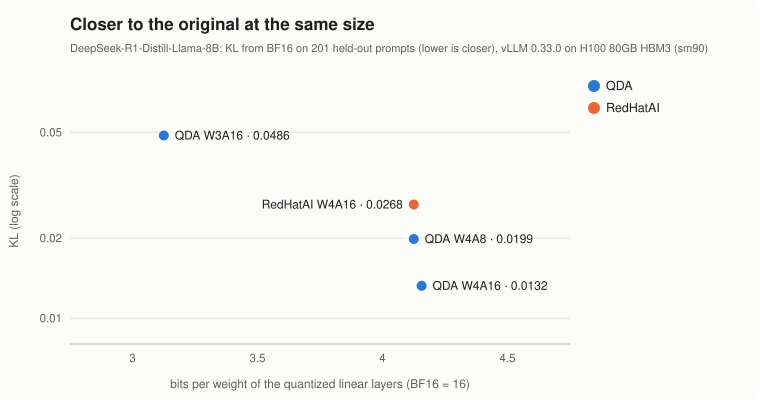

# Formats

What each format stores, which GPU serves it, and the GGUF exporter. For anyone choosing a format or a card.

| format | weights | activations | Qwen3.8-27B on disk (BF16: 55.6 GB) | engine |
|---|---|---|---|---|
| `w4a16` | 4-bit, asymmetric (MoE experts: symmetric, below), groups of 128 | BF16 | 19.5 GB | vLLM |
| `w3a16` | 3-bit, symmetric, groups of 128 | BF16 | 14.5 GB | vLLM |
| `w4a8` | 4-bit, symmetric, groups of 128 | FP8, per token | 19.5 GB | vLLM, Hopper only |
| `w4a4` | NVFP4: FP4 E2M1, an FP8 E4M3 scale per 16, a global scale | NVFP4, quantized on the fly | 21.9 GB | vLLM 0.33, [B200 (sm100) / GB300 (sm103) / RTX PRO 6000 (sm120)](#does-my-gpu-run-it) |
| GGUF Q4_K_M | llama.cpp K-quants | | | llama.cpp |

A spelled-out name sets symmetry and group size: `w4a16-sym-g128`, `w4a16-asym-g64`. A bare `w4a16` means
`w4a16-asym-g128`, except on MoE models: experts in bank groups (routed and banked shared) are stored symmetric at
the same group size (`w4a16-g64` gives `sym-g64` experts). AWQ refuses that mix (`requires explicitly asymmetric
W4A16`); for AWQ on a MoE write `format: w4a16-asym-g128`. `w4a4` means `w4a4-nvfp4`.

FP8 W8A8 (`w8a8-fp8`) is no format of its own: W4A4 uses it for a mixed NVFP4 + FP8 build (`formats:` overrides)
and for an FP8 output head (`head: {format: w8a8-fp8}`). Dense layers need compute capability 8.9; QDA writes no
FP8 expert bank.

## Head lease

The head lease stores an untied output head narrower and lends what it saves to the body. The head is charged 16 bits a
weight, so a body and head fit when `(body bits + head bits - 16 x head weights) / body weights` fits the
[budget](search.md#budget). Beside W4A16/W3A16 the head takes bf16, `w8a16` or `w4a16`; beside W4A8, bf16 or `w8a16`;
beside W4A4, bf16 or FP8 (`w8a8-fp8`), at the body's group size and, within its family, its symmetry.
Who turns it on: [bits per weight](search.md#bits-per-weight).

Qwen3-8B, candidate 0 of `qda-agent prepare` (plain GPTQ, no search): W4A16 is 6.1 GB at KL 0.025, W3A16 5.2 GB at
KL 0.149.

DeepSeek-R1-Distill-Llama-8B, published checkpoints against RedHatAI's W4A16, on the same 201 held-out prompts. At
nearly the same size (4.16 and 4.13 bits per weight), QDA's W4A16 is at KL 0.013, RedHatAI's at 0.027:



## Does my GPU run it

<!-- BEGIN generated: support-matrix -->
<!-- generated by tools/gen_docs.py; edit the code, not this block -->

Find the card you will **serve** on. A checkpoint can be built on any card for another one (`--set target=h100`).

✅ observed on a card · ❌ refused. Where dense and MoE layers differ, the cell names both.

| GPU | W4A16 | W3A16 | W4A8 | W4A4 |
|---|---|---|---|---|
| H100 / H200 / H800 | ✅ | ✅ | ✅ | ❌ Blackwell only |
| A100 | ✅ | ✅ | ❌ Hopper only | ❌ Blackwell only |
| L40S | ✅ | ✅ | ❌ Hopper only | ❌ Blackwell only |
| RTX PRO 6000 | ✅ | ✅ | ❌ Hopper only | ✅ |
| B200 | ✅ | ✅ | ❌ Hopper only | ✅ |
| GB300 | ✅ | ✅ | ❌ Hopper only | ✅ |

On a card marked ❌, build `w4a16` or `w3a16`: every card above serves both. A `w4a8` build on one of them stops with: "FP8 activations need Hopper: vLLM's CUTLASS W4A8 kernel needs compute capability 90 (H100 / H200); use w4a16".

DeepSeek V4.1 is served on H100 / H200 / H800 only. A V4.1 build for an RTX PRO 6000 stops with: "DeepSeek V4.1 does not run on an RTX PRO 6000 (sm120): vLLM 0.33's V4.1 indexer fails there in DeepGEMM's get_paged_mqa_logits_metadata (block_kv must be 32 or 64), and QDA has V4.1's prefill numerics for Hopper only; serve it on an H100 or H200 (build with --set target=h100)".

<!-- END generated: support-matrix -->

To turn a W4A16 recipe into W4A4, change `format:` to `w4a4`. A `gptq` or `rtn` step with no `clip`, or a range search
(`hmse`, `mse`, `imse`), runs `fp4hmse`, which searches the E4M3 scales NVFP4 stores, weighted by the Hessian;
`resolved.yaml` records it.

## GGUF for llama.cpp

`gguf-q4km` writes a llama.cpp file with the tensor types of `llama-quantize ... Q4_K_M`, holding GPTQ-solved codes.
The file includes the model's MTP head by default.

### Setup

```bash
uv pip install -c constraints.txt "./packages/qda-quant[hf,gguf]"
git clone https://github.com/ggml-org/llama.cpp && git -C llama.cpp checkout 9e2a04a439edc49f08c5acdafefae19dfa25a658
export QDA_LLAMA_CPP=$PWD/llama.cpp
```

A Linux wheel ships llama.cpp's Q4_K and Q6_K quantizers. The IQ, Q3_K and Q5_K types need a `libggml-base` built
from the checkout (`qda plan` prints the command):

```bash
cmake -S llama.cpp -B llama.cpp/build -DBUILD_SHARED_LIBS=ON -DGGML_NATIVE=ON && cmake --build llama.cpp/build --target ggml-base -j
```

A search also needs the checkout's `llama-server` (the hand-in load check) and `llama-imatrix` (`prepare`); KL and
the long-generation check run on vLLM. `qda-agent prepare --format gguf-q4km --dry-run` prints the build commands
while they are missing.

A search's long-generation check answers the bf16 decode of each `.gguf` with vLLM. It measures quantization error,
not `llama-server`'s kernels, chat template or sampler. To check those before shipping a GGUF, run
`python -m qda_kl.gguf.run` ([Measure a GGUF](#measure-a-gguf)).

### Measure a GGUF

For KL, see [a GGUF file](verify.md#a-gguf-file). To check the tensors `llama-server` loads, its long generations
and its throughput, build the pinned checkout with CUDA and the bridge, then run the harness.
`native` builds for the cards in this machine (CMake 3.24 or newer); to build for another machine, name its
cards' compute capability instead (90 for an H100 / H200, 100 for a B200, 103 for a GB300, 120 for an RTX PRO
6000, 89 for an L40S). The command `qda-agent prepare` prints already names the run's cards:

```bash
export LLAMA=$QDA_LLAMA_CPP BUILD=$QDA_LLAMA_CPP/build
cmake -S "$LLAMA" -B "$BUILD" -DGGML_CUDA=ON -DCMAKE_CUDA_ARCHITECTURES=native -DBUILD_SHARED_LIBS=ON \
  -DCMAKE_CUDA_HOST_COMPILER=/usr/bin/g++ -DLLAMA_BUILD_TESTS=OFF -DCMAKE_BUILD_TYPE=Release
cmake --build "$BUILD" --target llama-server llama-imatrix -j8
PROBE=$(python -c 'import importlib.resources; print(importlib.resources.files("qda_kl.gguf") / "probe.cpp")')
c++ -std=c++17 -O2 -shared -fPIC "$PROBE" \
  -I "$LLAMA/include" -I "$LLAMA/src" -I "$LLAMA/ggml/include" \
  -L "$BUILD/bin" -Wl,-rpath,"$BUILD/bin" -lllama -lggml -lggml-base -ldl -o "$BUILD/probe.so"
```

Run `python -m qda_kl.gguf.run CONFIG.yaml`; an existing `out`
is refused.

| key | what it sets |
|---|---|
| `llama_cpp`, `build`, `bridge` | the checkout, its build directory, the compiled `probe.so` |
| `model`, `tokenizer`, `out` | the GGUF, the HF tokenizer, the output directory |
| `runtime` | `gpu_layers`, per-slot `context`, `parallel`, `batch_tokens`, `threads`, `port`, `startup_timeout`, `kv_dtype: bf16`, `flash_attention: on` |
| `coordination` | `lock`, `status`, `label`, `holders`, `who` of your GPU scheduler; null only without speed runs |
| `gencheck` | null, or `prompts` JSONL (`id`, `domain`, `prompt`), `sampling` (with `samplers: [temperature, top_k, top_p]`), `chat_template_kwargs`, `loop`, `differences` |
| `speed` | null, or `batches`, `prompt_tokens`, `new_tokens`, `seed`, `warmups`, `repeats`; one exclusive GPU |

What it checks and measures:

- **Loaded tensors.** Through `LD_PRELOAD`, the bridge checks the names, shapes and storage types the server
  loaded against the GGUF. Skipped MTP layers are recorded; any other missing or changed tensor fails.
- **Generations.** Settings are checked in every response; raw requests, responses and token ids are kept. The same
  seed does not give vLLM's draws.
- **Speed.** Decode tokens/s per request and aggregate tokens/s including prefill, without warmups; median and range
  over `repeats`.

### Build or search

```bash
qda-agent prepare --model Qwen/Qwen3-8B --out work/q8b-gguf --format gguf-q4km
```

Or one build from a recipe:

```yaml
model: Qwen/Qwen3-8B
format: w4a16-asym-g32               # Q4_K's codes and groups
grid: q4k
steps: [{gptq: {clip: imatrix, damp: 0.1}}]   # [{rtn: {}}] writes llama-quantize's own file
calib: {file: {path: calib.jsonl, samples: 128, seqlen: 2048}}
exporter: {gguf: {}}
out: out/q8b-q4km                    # qda build writes out/q8b-q4km/model-Q4_K_M.gguf
```

Render `calib.jsonl` in the model's own chat template first:

```bash
qda calib render --model Qwen/Qwen3-8B --names chat=3,multilingual=2 --samples 128 --seqlen 2048 --out calib.jsonl
```

### Exporter settings

| setting | meaning |
|---|---|
| `llama_cpp` | the llama.cpp checkout; default `QDA_LLAMA_CPP` |
| `template` | a bf16 GGUF you already have; the build reads it instead of converting |
| `libggml` | the `libggml-base` to quantize with; default the wheel's, then the checkout's build |
| `tensor_types` | ordered `{pattern, type}` rules on GGUF tensor names (below) |
| `mtp` | write the multi-token-prediction (MTP/NextN) head the template holds; default `true`. `false` leaves the head's blocks out, as `convert_hf_to_gguf.py --no-mtp` does, and is refused when a step changed one of their tensors |
| `imatrix` | a `llama-imatrix` file that weights the fit of tensors taken from the template |
| `workers` | quantizer threads; the bytes do not depend on it |

`tensor_types` rules name GGUF tensors (`blk.0.attn_q.weight`), exactly or with a `re:` regex; the last match wins:

```yaml
model: Qwen/Qwen3-8B
format: w4a16-asym-g32
grid: q4k
steps: [{gptq: {clip: imatrix, damp: 0.1}}]
calib: {file: {path: calib.jsonl, samples: 128, seqlen: 2048}}
out: out/q8b-custom
exporter:
  gguf:
    tensor_types:
      - {pattern: 're:blk\.\d+\.attn_v\.weight$', type: Q8_0}
      - {pattern: output.weight, type: Q6_K}
```

| tensor type | solved format | requirements |
|---|---|---|
| `Q4_K` | `w4a16-asym-g32` | grid `q4k` |
| `Q5_K` | `w5a16-asym-g32` | grid `q5k`, native `libggml` |
| `Q6_K` | `w6a16-sym-g16` | grid `q6k` |
| `IQ4_XS` | `w4a16-iq4xs` | grid `iq4xs`, native `libggml` |
| `IQ4_NL` | `w4a16-iq4nl` | grid `iq4nl`, native `libggml` |
| `Q3_K` | `w3a16-q3k` | grid `q3k`, native `libggml` |
| `IQ3_S` | none | native template fit only |
| `Q8_0` | none | Python template fit; ignores importance weights |

A tensor whose format or type does not match is fitted from the template and listed in `build.json` under
`gguf.rounded_from_template`. To store a routed bank's down projections wider, give them a `format_overrides` rule
and a matching `tensor_types` rule (GGUF only).

### Quality

Qwen3-8B, Q4_K_M (5.03 GB), KL from BF16 on 48 prompts, 128 calibration samples of 2,048 tokens:

| build | KL | runs |
|---|---:|---:|
| `llama-quantize`, no importance matrix (`rtn` writes the same file) | 0.027183 | 1 |
| `qda build`, `gptq` | 0.016349 | 3 |
| `llama-quantize --imatrix` | 0.014265 | 3 |
| `qda build`, `gptq`, `clip: imatrix` | 0.013501 | 3 |
| `qda build`, `gptq`, `clip: imatrix`, `damp: 0.1` | 0.012751 | 3 |

`damp: 0.1` is tuned on this same KL: read its margin as an upper estimate. Each file is scored as in
[a GGUF file](verify.md#a-gguf-file).

With `rtn`, the file is byte-identical to `llama-quantize`:

```bash
python llama.cpp/convert_hf_to_gguf.py path/to/model --outtype bf16 --outfile model-bf16.gguf
llama.cpp/build/bin/llama-quantize model-bf16.gguf ref.gguf Q4_K_M
cmp out/q8b-q4km/model-Q4_K_M.gguf ref.gguf && echo identical
```

### Limits

- Methods: `rtn` and `gptq`, with clip `minmax` or `imatrix`. Other clips, AutoRound and GSQ are refused.
- A 32-value block whose largest magnitude is at most 3.732e-37 (Q8_0) or 4.702e-38 (Q5_0 without importance
  weights) gets x86 `llama-quantize`'s bytes on every machine; an aarch64 `llama-quantize` writes other codes
  there, so `cmp` against it fails.
- Models: dense `llama`, `qwen2`, `qwen3`, `qwen35`, and `qwen35moe` expert banks; rows must be multiples of 32.
- The file is always named `model-Q4_K_M.gguf`; a custom mix records `gguf.mix: custom` in `build.json`.
