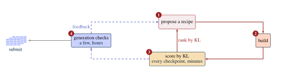

# Agent search

When one `qda build` misses your KL, run a search: a coding agent builds recipes for one model, one format and one
size budget on your GPUs until a deadline. On a W4A16 code fine-tune, 3 hours on 4 GPUs took held-out KL from
0.0252 (candidate 0, plain GPTQ) to 0.0128 at the same size.

## Three commands

```bash
qda-agent prepare --model Qwen/Qwen3-8B --out work/q8b --format w4a16 --cards 0,1,2,3 --budget-gpu-hours 6
qda-agent search work/q8b
qda eval work/q8b/run
```

| step | what it does | Qwen3-8B on 4× H100 | Qwen3-Coder-30B-A3B (MoE) on 4× H100 |
|---|---|---|---|
| `prepare` | downloads the model; builds the KL prompts, the original's reference, a calibration set in the model's chat template, and candidate 0 (plain GPTQ, the baseline to beat); writes `work/q8b/search.yaml` | 458 s on one H100, 2009 s on one A100, 23.7 GB of disk | 1642 s, of which the download is 850 s |
| `search` | runs `qda doctor --search`, a trial run, then the agent until the budget is spent | the budget | the budget |
| `qda eval RUN_DIR` | scores the winner and candidate 0 on held-out prompts ([validate](#validate-the-result)) | — | 264 s |

- On one card, pass `--cards 0`: `--cards 0,1,2,3` exits 3 on a machine with fewer cards. The default 4 GPU-h budget
  on one card is a 4-hour search.
- `prepare` builds the reference on one of the cards, without tensor parallelism, when the model's weights fill at
  most 56% of one card's memory (Qwen3-8B on an H100); a larger model splits over the most of `--cards` vLLM
  accepts. The step's log says which.
- To check your setup in 15 minutes on one card (too short to beat candidate 0):
  `qda-agent prepare --model Qwen/Qwen3-0.6B --out work/q06b --cards 0 --budget-gpu-hours 0.25`. Its `prepare` takes
  517 s on one H100, 460 s of it the KL reference (916 s and 844 s on one A100 80GB). The reference grows with the
  model: Qwen3-8B takes 1574 s on one RTX PRO 6000 (23 s of it engine start). The reference step prints nothing after
  the engine starts: wait for it.
- Before `prepare`, add `--dry-run`: it prints the steps and the disk they need. After an interruption, rerun
  `prepare`: it skips every step whose output is complete.
- `--model` takes a Hub id or a local directory ([your model](quantize.md)). Pin a Hub id to a commit
  (`Qwen/Qwen3-8B@<commit>`); without one, `prepare` downloads `main`.
- `--format` is `w4a16` (default), `w3a16`, `w4a8`, `w4a4` or `gguf-q4km` ([GGUF setup](formats.md#gguf-for-llamacpp)).
- For a domain model, add `--calib FILE`: candidate 0 and the search calibrate on that JSONL as is.
- When `gate` or `search` runs on other cards than `prepare` did (a new Slurm job), name them:
  `qda-agent search work/q8b --set "cards=[6,7]"`.
- Before the first API spend, run `qda-agent gate work/q8b/search.yaml --set run_dir=work/q8b/gate`: the search's start
  checks, trial run and candidate 0's reading, with no agent turn, written to `gate.json`. The gate skips
  `qda doctor --search`: run that too, or a missing sign-in passes.
- Before the agent's first turn, the trial run builds the model with plain `rtn` as an agent's job does and checks
  it as a hand-in is checked. If either fails, the run exits 3
  ([exit status](troubleshooting.md#exit-status)) with that step's error, and candidate 0 is the result
  (`FINAL.json`, `agent_ran: false`).
- After a start that failed, the run directory is not empty: rerun with a new one,
  `qda-agent search work/q8b --set run_dir=work/q8b/run2`.

## Budget

Whoever pays for the cards sets the budget before `search`:

| budget | default | set it with |
|---|---|---|
| GPU hours, over all cards | 4 | `prepare --budget-gpu-hours 32`, or `search --set budget_gpu_hours=32` |
| bits per weight of the result | W4A16 / W4A8 4.4, W3A16 3.4, W4A4 4.8; candidate 0's file size for `gguf-q4km` | `prepare --budget-bpw` ([below](#bits-per-weight)) |
| agent API spend, USD | none | `search --set agent.cost_usd=400` |

The deadline is GPU hours divided by cards: 32 GPU hours on 4 cards is an 8-hour search. A checkpoint above the
bpw budget is refused.

Give the search a deadline of at least 1.5 hours (on 4 cards, at least 6 GPU hours). The start phase took 4-5 min on
an H100 and 26 min on a GH200. In three Qwen3-8B searches on one H100 (deadlines 1 h, 1 h, 1.5 h), two read their
first candidate below candidate 0 38 and 45 min after the agent's first turn and checked its hand-in 5 min later; the
third had none after 47 min.

When the spend reaches `agent.cost_usd`, the agent stops and the run ends as at the deadline: the
[`handin` rule](search-config.md#judge-keys) picks the result. `END-REPORT.md` prints the spend.

### Bits per weight

`prepare --budget-bpw` takes one of:

| value | budget |
|---|---|
| none | the default in the table above |
| `N` | `N` bits per quantized weight (`judge.budget_bpw`); vLLM formats only |
| `candidate0` | candidate 0's own bpw, or its `.gguf` bytes |
| `hf:ORG/NAME[:FILE]` | a published checkpoint's size, read without its weights: a GGUF file's bytes (all parts of a split GGUF), or a compressed-tensors, GPTQ or AWQ checkpoint's bpw from its safetensors headers |

A GGUF price needs `--format gguf-q4km`, a safetensors price a vLLM row; any other checkpoint is refused before the
first step. `prepare.json` records the repository and commit read, so running the same prepare again prices the same
commit without the Hub; `search.yaml` names the source above the budget key.

Bits per weight count the model body's decoder Linears (codes, scales, zero points; a Linear kept bf16 counts 16)
over the original's decoder-Linear weights. With the [head lease](formats.md#head-lease) on, they count the head too,
as the lease charges it; off, the head is not in them. The end-of-run card prints the same number.

`qda-agent prepare` turns the head lease on for W4A4 and off for the other rows; `--head-lease` turns it on for any
vLLM row, `--no-head-lease` off; `gguf-q4km` refuses it.

## Cards and clusters

`--cards` takes physical GPU numbers, as `nvidia-smi` lists them, never positions in `CUDA_VISIBLE_DEVICES`. When
`CUDA_VISIBLE_DEVICES` is set, name only cards it lists (`CUDA_VISIBLE_DEVICES=4,5` takes `--cards 4,5`), or unset
it; any other card exits 3 with `cards [0] are not in CUDA_VISIBLE_DEVICES='4,5'`. The search holds these cards
for its whole budget; the agent's builds and the KL readings share them through a queue.

On Slurm, run the search inside one job on one node:

```bash
#!/bin/bash
#SBATCH --job-name=qda-search
#SBATCH --nodes=1
#SBATCH --gpus=4
#SBATCH --cpus-per-task=32
#SBATCH --time=12:00:00          # longer than budget / cards
cd "$SLURM_SUBMIT_DIR"
qda-agent search work/q8b --set "cards=[$CUDA_VISIBLE_DEVICES]"
```

- Set `cards` from `CUDA_VISIBLE_DEVICES`, as above: a card the job does not hold is refused. Run `prepare` the
  same way, in a short GPU job: `--cards "$CUDA_VISIBLE_DEVICES"`.
- Put the agent's builds on node-local disk: `--set work_dir=/var/tmp/q8b-work`. At `isolation.level: sandbox` or
  `strict`, keep `prepare --out` outside `/tmp` and `/var/tmp`, which the agent can write; the start refuses it there.
- Give the compute node a route to the agent's API.
- Keep twice the original model's bf16 weights free on the run's disk (`judge.min_free_bytes`): below that,
  `prepare` and the start refuse, and builds stop.
- Plan 4-7x candidate 0's size for the run directory: 3.6 GB for Qwen3-0.6B W4A16 at 0.25 GPU-h, 21 GB for
  Qwen3.5-4B at 1 GPU-h, 101 GB for Qwen3-Coder-30B-A3B at 4 GPU-h, plus the downloads and the free-space floor.
  `prepare --dry-run` prints the estimate for your model.

## The agent

`search` drives a coding agent. Claude Code is the default: install it (`curl -fsSL https://claude.ai/install.sh | bash`) and sign in once (`claude`). For a run
at `isolation.level: sandbox` or `strict` that outlasts the sign-in, follow [Sign-in](search-config.md#sign-in). A sign-in the provider refuses shows only at the first agent turn,
about 3 minutes after the start, as `HarnessRefused`: run `claude` to sign in again, then rerun with a new run
directory (`--set run_dir=work/q8b/run2`).

| backend | `--backend` | verified with |
|---|---|---|
| Claude Code | `claude` | a full search, `claude-opus-5-5` |
| DeepSeek (DeepSeek Harness) | `dsh` | a full search, `deepseek-v4.1-flash-1017` through a gateway |
| Codex | `codex` | a full search, `gpt-6.2-sol` |

For DeepSeek, run `uv pip install -c constraints.txt "./packages/qda-agent[dsh]"`, export `DEEPSEEK_API_KEY` (and
`DEEPSEEK_BASE_URL` for a gateway; default the official DeepSeek API), then `prepare --backend dsh` (it writes no `model`, so the run takes the one its endpoint serves; name one with
`--backend '{name: dsh, model: NAME}'`). Before
`search`, run `qda doctor --search work/q8b/search.yaml`: it says whether the agent is ready.

Claude Code and DeepSeek reach the same average over six benchmarks (AIME25, HMMT Feb 2026, GPQA-Diamond, IFBench /
IFEval, MMLU-Pro, LiveCodeBench): Qwen3.8-27B W4A16 80.6 with Claude Code, 81.2 with DeepSeek;
DeepSeek-R1-Distill-Llama-8B W3A16 37.2 and 36.6.

**Warning.** The agent runs with approvals bypassed. At `isolation.level: none` (the default) the build and command
jobs it submits run as you, outside any sandbox, and can change or delete any file your account can write. Where
bubblewrap works, run at `strict` (`prepare` writes `sandbox: {name: none}`, so set both keys):

```bash
qda-agent search work/q8b --set isolation.level=strict --set "sandbox={name: bwrap}"
```

Elsewhere, run where you can afford to lose what your account can write. The levels, and a node whose `pid rule`
row is a MISS: [isolation](search-config.md#isolation).

## Watch a run

`search` prints one line per event on stderr (a checkpoint handed in, its KL, a refusal) with elapsed and remaining
time, and a line after ten quiet minutes. From another terminal, `qda-agent status work/q8b/run` prints the same
view.

A run leaves, in `work/q8b/run/`:

- `FINAL.json`: the picked checkpoint, the rule that picked it, its score.
- `END-REPORT.md`: the pick, the commands to serve it and to score it (`qda eval`), and the judge's readings. The
  serve line names no card, so vLLM starts on card 0: to serve on card 2, put `CUDA_VISIBLE_DEVICES=2` directly before `vllm serve`.
  When the pick has no KL reading, or every reading is worse than candidate 0, its first line and `FINAL.json`'s
  `warnings` give both KLs and the serve line of candidate 0.
- `resolved.yaml`: the config with every path absolute. `qda-agent run work/q8b/run/resolved.yaml --set run_dir=work/q8b/run2`
  repeats the setup into `work/q8b/run2`.
- `work/`: the agent's notes, scripts and checkpoints. `flow.jsonl`, `tools.jsonl`: what the loop and the agent did.

## Validate the result

After a search, run `qda eval RUN_DIR`: it reads the winner's and candidate 0's KL on held-out prompts no build
calibrated on, then prints a verdict (here a Qwen3-0.6B run where nothing beat candidate 0):

```text
               holdout KL  vs cand 0  checkpoint
candidate 0      0.164612      1.000  work/q06b/run/cand0-gptq
winner           0.164612      1.000  work/q06b/run/win425
verdict: ... (0.164612 vs 0.164612)
```

When the agent never ran, `qda eval` prints the candidate 0 row only, and the verdict says why (120 s for Qwen3-0.6B
on one H100).

To score candidate 0 alone (after `prepare` or `gate`, which leave no `FINAL.json`), name its checkpoint and a suite:
`qda eval work/q8b/cand0-gptq --suite kl` writes to `work/q8b/cand0-gptq-eval/kl`. Benchmarks
(`--suite full`, `sanity`, `specdec`): [validate a checkpoint](verify.md#4-benchmarks).

## How the search works



1. **Propose and build.** The agent writes a recipe and queues `qda build`.
2. **Score by KL, in minutes.** `kl DIR` reads the checkpoint's next-token distributions on fixed prompts, in vLLM,
   with the kernel it will be served with, and compares them with the original model's.
3. **Check long generations.** `gencheck DIR` counts answers cut off or stuck in a loop, which KL on fixed text
   misses.
4. **Hand in.** `handin DIR [DIR...]` submits a ranked list ([final rule](search-config.md#judge-keys)).

Every build's calibration is filtered against the prompts KL reads; the final reading uses held-out prompts.

The agent has no GPU of its own. It reaches the cards only through its tools: `qda` (build, plan), `kl`,
`gencheck`, `qsched` (a GPU queue for any script), `handin`, `bpw`, `wiki` (method notes), and a copy of
`qda_quant` it may change. Every part is a plugin ([search config](search-config.md#parts)).
